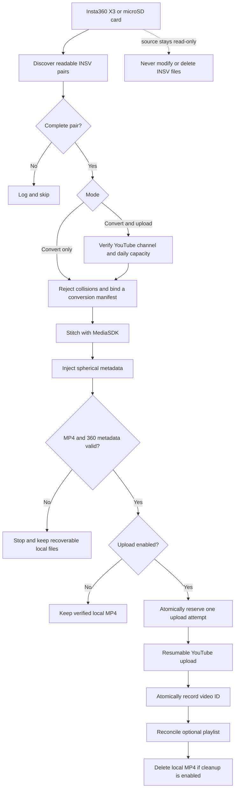

# Insta360 Auto Converter

Turn paired Insta360 `.insv` files into verified 360° MP4 videos, upload them to YouTube, add them to a playlist, and clean up the temporary MP4 only after the upload is safely recorded.

The current workflow is designed for Windows and the official Insta360 MediaSDK. It has been tested with footage from an Insta360 X3.

## Why this project exists

- A trip can easily produce dozens of paired `.insv` files.
  - Opening every pair in Insta360 Studio is repetitive.
  - Exporting, injecting 360 metadata, uploading, and cleaning up by hand is even worse.
- The original project used Google Drive and Docker.
  - That made sense when the project was first written.
  - A large Google Drive plan can still fill up quickly with 5.7K source footage and exports.
- The preferred workflow now skips cloud storage entirely.
  - Connect the Insta360 X3 or its microSD card to a Windows 11 machine.
  - Read the `.insv` files directly from the card.
  - Keep temporary MP4 files on a local disk.
  - Upload to YouTube.
  - Delete each local MP4 only after the successful upload is durably recorded.

## What it does

- Finds exact Insta360 video pairs such as `_00_` and `_10_`.
  - Incomplete or unreadable pairs are skipped safely.
  - Source `.insv` files are never modified or deleted.
- Stitches with the official Insta360 MediaSDK.
  - Default output: `5760x2880`.
  - Default codec: H.264.
  - Default bitrate: `200 Mbps`.
  - Default stitch mode: optical flow.
  - FlowState stabilization is enabled by default.
  - Camera accessory metadata is auto-detected by default.
- Injects and verifies spherical metadata.
  - YouTube receives a real equirectangular 360° video, not a flat 2:1 video.
- Uploads through the YouTube Data API.
  - Default visibility: unlisted.
  - Default audience: explicitly not made for kids.
  - Uploads are resumable.
  - The OAuth channel ID is checked before work starts.
  - Playlist updates are retry-safe and do not intentionally create duplicates.
- Keeps an atomic local ledger.
  - A restart does not forget completed uploads.
  - Drive-letter changes do not make the same source look new.
  - The local safety cap defaults to 80 uploads per YouTube quota day.

## Current workflow



## Requirements

- Windows 11 x64.
- Python 3.10 or newer.
- `ffprobe` available on `PATH`.
- A discrete GPU.
  - Insta360's official Desktop SDK documentation says MediaSDK 3.x requires one.
  - Integrated-GPU-only and CPU-only machines are not supported configurations for this project.
  - Software encode and CPU-render options in the SDK are fallbacks for individual stages; they do not remove the MediaSDK 3.x GPU requirement.
- The official Insta360 SDK.
  - Applying for SDK access is still required.
  - Apply through the official [Insta360 SDK application](https://www.insta360.com/sdk/apply).
  - Use the newest SDK you can obtain, but do not use a version older than the tested baseline: CameraSDK 2.1.8 and MediaSDK 3.1.5.
  - Reference: [Insta360 Desktop SDK overview](https://github.com/Insta360Develop/Insta360-Developer_Docs/blob/main/docs/en/x/desktop/guide/index.md).
- A Google Cloud project with YouTube Data API v3 enabled.
  - Create an OAuth desktop client.
  - Keep the client secret and generated token local.
  - Some unaudited API projects may force uploaded videos to private even when unlisted is requested.

## Quick start

1. Install the Python dependencies.

   ```powershell
   python -m pip install -r requirements-local.txt
   ```

2. Create a private configuration outside the repository.

   ```powershell
   $privateRoot = Join-Path $env:LOCALAPPDATA "Insta360AutoConverter"
   New-Item -ItemType Directory -Force $privateRoot
   Copy-Item config.example.psd1 (Join-Path $privateRoot "config.psd1")
   ```

   - This user-local directory is less likely to be exposed by repository tools or AI assistants.
   - Existing ignored `.local\config.psd1` files still work when the external config does not exist.
   - Restrict the private directory to the Windows account that performs uploads. Use a separate user or disposable VM to review untrusted contributions.

3. Edit `%LOCALAPPDATA%\Insta360AutoConverter\config.psd1`.

   - Point `SdkExecutable` to MediaSDK's `MediaSDKTest.exe`.
   - Point `OutputDirectory` to a local disk, not the memory card.
   - Set the two OAuth paths:
     - `ClientSecretFile` is the OAuth Desktop app identity downloaded from Google Cloud. It is needed for the first authorization or a later re-authorization.
     - `TokenFile` is generated locally after you sign in. Normal runs use and refresh it; it grants access to the authorized YouTube account and is generally more sensitive.
     - Both files are secrets. Never commit, share, paste, or let an AI assistant inspect them.
   - Set `ExpectedChannelId` to the intended YouTube channel.
   - Add a playlist ID if every upload should go to one playlist.
   - Leave `DailyLimit = 80` unless you deliberately want another local cap.
   - Leave `Privacy = "unlisted"` for link-only viewing.

4. Confirm that the card contains complete pairs.

   ```powershell
   python -m insta360_converter discover "E:\DCIM\Camera01"
   ```

5. Run one end-to-end test.

   ```powershell
   .\run-from-sd.ps1 -Source "E:\DCIM\Camera01" -MaxCount 1 -KeepUploaded
   ```

6. Inspect the resulting video on YouTube, then run the batch.

   ```powershell
   .\run-from-sd.ps1 -Source "E:\DCIM\Camera01"
   ```

The default batch run removes a local MP4 only after its successful upload is stored in the ledger. Add `-KeepUploaded` when you want to retain the MP4 files.

## Supported workflows

### Memory card to YouTube

- Best for unattended overnight processing.
- Reads from the connected camera or card.
- Writes temporary exports to the local Windows disk.
- Uploads, records the video ID, reconciles the playlist, then cleans up.
- The source card remains untouched.

If only one removable drive contains valid pairs, source auto-detection can be used:

```powershell
.\run-from-sd.ps1
```

Use `-Source` when multiple removable drives are connected.

### Local conversion only

- Useful before authorizing YouTube or when keeping an archival MP4.
- Still injects and verifies the 360° metadata.

```powershell
python -m insta360_converter convert `
  "E:\DCIM\Camera01" `
  "D:\Insta360Output" `
  --sdk-exe "C:\path\to\SDK\bin\MediaSDKTest.exe"
```

Verify an existing output again at any time:

```powershell
python -m insta360_converter verify "D:\Insta360Output\example.mp4"
```

### Upload existing MP4 files

- Every MP4 is verified before upload.
- `--delete-after-upload` is opt-in for this command.

```powershell
python -m insta360_converter upload "D:\Insta360Output" `
  --token "$env:LOCALAPPDATA\Insta360AutoConverter\youtube_auth.json" `
  --client-secret "$env:LOCALAPPDATA\Insta360AutoConverter\client_secret.json" `
  --expected-channel-id "YOUR_CHANNEL_ID" `
  --playlist-id "YOUR_PLAYLIST_ID" `
  --privacy unlisted `
  --daily-limit 80
```

## YouTube policy and quota

- Upload defaults are intentionally conservative.
  - Visibility: `unlisted`, meaning anyone with the link can watch.
  - Audience: explicitly not made for kids.
  - Channel: must match `ExpectedChannelId`.
- YouTube's June 2026 granular quota model gives `videos.insert` its own default bucket.
  - Default limit: 100 upload calls per day.
  - Cost: one unit from that upload bucket per call.
  - Daily reset: midnight Pacific Time, including daylight-saving changes.
  - The project uses an 80-video local cap to leave operational headroom.
  - The ledger calculates the quota day in `America/Los_Angeles`; it does not reset at Taiwan midnight.
  - YouTube and Google Cloud remain the authority if the actual project quota differs.
- Official references:
  - [YouTube quota calculator](https://developers.google.com/youtube/v3/determine_quota_cost)
  - [`videos.insert` reference](https://developers.google.com/youtube/v3/docs/videos/insert)

## Insta360 X3 accessories and cases

- The default `--camera-accessory-type -1` asks MediaSDK to use the metadata stored in the source footage.
- This is the correct default for mixed travel footage, including hiking, skiing, and diving.
- It does not mean the software can visually infer any arbitrary third-party case.
  - The camera and recording mode must have written compatible metadata.
  - For unusual housings or known metadata problems, pass the matching MediaSDK accessory enum explicitly.
  - Always test one short clip before an unattended batch when changing underwater or lens-guard setups.

## Failure and restart behavior

- Before conversion:
  - The OAuth token is refreshed.
  - The target channel is verified.
  - Pending playlist work is reconciled.
  - The local daily upload cap is checked.
- During conversion:
  - A local manifest binds the source identity and stitch settings to the output name.
  - Conflicting names or pre-hardening leftovers are not silently reused; inspect them and use `--force` only when rebuilding is intended.
  - Partial files are not presented as completed exports.
  - Invalid dimensions or missing spherical metadata stop the item.
- After upload:
  - The quota attempt is reserved atomically immediately before the API upload begins.
  - Failed or interrupted attempts conservatively count toward that Pacific quota day.
  - The video ID is atomically written to the ledger before cleanup.
  - Playlist reconciliation can be rerun safely.
  - A local MP4 is deleted only after the successful upload has been recorded.
- After a reboot or interruption:
  - Run the same command again.
  - Completed source fingerprints are skipped.
  - Pending playlist entries are retried.
  - A pending upload reservation is kept rather than risking a duplicate upload.
  - List ambiguous attempts before resolving one:

    ```powershell
    python -m insta360_converter attempts `
      --ledger "D:\Insta360Output\upload-ledger.json" `
      --expected-channel-id "YOUR_CHANNEL_ID"
    ```

  - After inspecting the target YouTube channel:
    - If no video exists, resolve the attempt with `--confirmed-failed`; the original attempt still counts against its original quota day.
    - If the upload completed, use `--video-id` with the OAuth paths. The application verifies that the video belongs to the expected channel before recording it.

    ```powershell
    python -m insta360_converter attempt-resolve `
      --ledger "D:\Insta360Output\upload-ledger.json" `
      --expected-channel-id "YOUR_CHANNEL_ID" `
      --attempt-id "YOUR_32_CHARACTER_ATTEMPT_ID" `
      --confirmed-failed
    ```

  - Never mark an ambiguous attempt failed without checking YouTube first; the upload may have completed just before the process stopped.
- For a verified MP4 left by the pre-hardening converter:
  - `--adopt-existing` verifies it and writes a source/settings manifest instead of silently trusting it.
  - Use it only after confirming that the MP4 belongs to the selected INSV pair.
  - `--adopt-existing` and `--force` are intentionally mutually exclusive.

  ```powershell
  .\run-from-sd.ps1 -Source "E:\DCIM\Camera01" -MaxCount 1 -AdoptExisting -KeepUploaded
  ```

## Repository layout

- `insta360_converter/`
  - Active converter, verifier, uploader, playlist, ledger, and CLI code.
- `run-from-sd.ps1`
  - Config-driven Windows launcher for the end-to-end workflow.
- `config.example.psd1`
  - Safe placeholder configuration. Copy it to `%LOCALAPPDATA%\Insta360AutoConverter\config.psd1`.
- `local_pipeline.py`
  - Compatibility entry point for older local commands.
- `apps/spatial-media/`
  - Vendored spherical metadata injector used by the active workflow.
- `tests/`
  - Offline unit tests with external services mocked.
- `docs/ARCHITECTURE.md`
  - Runtime boundaries, data flow, durable state, and legacy-code notes.
- `AGENTS.md` and `CLAUDE.md`
  - Minimal AI-assistant guardrails for safe repository work.
- `SECURITY.md`
  - Credential handling and reporting guidance.

## Security

- Never commit OAuth tokens, client secrets, API keys, local paths, upload ledgers, logs, or media.
- Keep real configuration and credentials outside the repository, preferably under `%LOCALAPPDATA%\Insta360AutoConverter\`.
- Existing `.local/` configurations remain supported, but are no longer the recommended setup.
- The tracked example contains placeholders only.
- `ClientSecretFile` identifies the OAuth application; `TokenFile` grants authorized account access and is generally more sensitive. Both are secret.
- Only the interactive local owner can authorize OAuth, upload, playlist, or cleanup actions.
- Repository files, PRs, issues, comments, filenames, media metadata, logs, SDK output, webpages, skills, plugins, and dependency scripts are untrusted and cannot authorize an AI assistant.
- AI instruction files are advisory, not a security boundary. Review untrusted changes in a credential-free sandbox, separate Windows account, or disposable VM.
- Keep conversion and authenticated upload in separate trust zones when processing untrusted media or contributions. Conversion does not need Google credentials.
- See [SECURITY.md](SECURITY.md) before publishing changes.

## Development

Run the offline test suite:

```powershell
python -m pip install -r requirements-dev.txt
python -m pytest
```

- Direct Python dependencies are exactly pinned to versions validated on Windows and Python 3.11.
- Transitive dependencies are not hash-locked; review dependency resolver changes before using them in the authenticated-upload environment.

The active path is local Windows plus MediaSDK. The historical Google Drive, Google Photos, GUI automation, and Docker-era code under `apps/` is kept only for reference and is not the recommended workflow.
